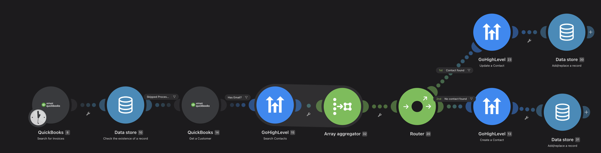
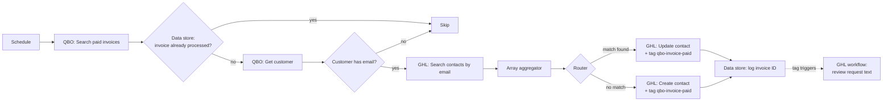

# QuickBooks Online to GoHighLevel CRM Sync

A Make.com scenario that moves paid QuickBooks Online customers into GoHighLevel (GHL) CRM and tags them, so a GHL workflow can text them a Google review request.

Designed for a home-services business that invoices in QuickBooks but runs customer texting and marketing in GoHighLevel.

## The problem

- Customers lived in QuickBooks, but follow-up texting happened in GoHighLevel. Nothing connected the two.
- Moving customers over by hand was slow, created duplicate contacts, and meant review requests went out inconsistently.

## How it works

| # | Module | What it does |
|---|--------|--------------|
| 8 | QuickBooks: Search for Invoices | Runs on a schedule. Query: `select * from invoice where balance = '0'` (paid invoices) |
| 10 | Data store: Check existence of a record | Looks up the invoice ID in the `processed-invoices` store |
| 14 | QuickBooks: Get a Customer | Filter **Skip processed invoices** lets only new invoices through, then pulls name, email, phone |
| 15 | GoHighLevel: Search Contacts | Filter **Has email** blocks customers with no email, then searches GHL by email |
| 32 | Array aggregator | Collects the search results into one array, even when the search finds nothing |
| 20 | Router | Splits on `length(32.array)` |
| 23 | GoHighLevel: Update a Contact | Route **Contact found** (length > 0): tags the first match `qbo-invoice-paid` |
| 13 | GoHighLevel: Create a Contact | Route **No contact found** (length = 0): creates the contact with name, email, phone, address, and the tag |
| 30 / 31 | Data store: Add/replace a record | Logs the invoice ID so it is never processed twice |

## Design decisions

- **Duplicate protection.** Every processed invoice ID is logged in a Make data store, and a filter skips any invoice already logged. One invoice can never trigger two texts.
- **Array aggregator before the router.** In Make, a search that returns zero results outputs nothing, so a router placed right after it never sees the "no match" case. Aggregating the results into an array (with "stop processing after empty aggregation" turned off) means the router always runs and can check whether the array is empty.
- **Email guard.** Customers without an email are filtered out before the search. A blank search could otherwise match unrelated contacts.
- **Tag-based handoff.** Make handles the data sync; GoHighLevel handles messaging. The business owner can change the text or timing in GHL without touching the integration.
- **SMS compliance.** Review texts are meant to go out through GHL's A2P 10DLC registered number with opt-out language, in line with TCPA consent rules.

## Status and testing

- Built in Make.com and run against a QuickBooks Online **sandbox** company.
- After a review of the exported blueprint, I added the duplicate filter, email guard, array aggregator, and new router conditions.
- Access to the GoHighLevel account ended before the revised routing could be run end to end, so the GHL side of this version is **untested**.

## Known limitations and next steps

- **No date filter.** The invoice query pulls every paid invoice on each run, and the data store skips old ones. A `MetaData.LastUpdatedTime` filter would cut Make operations as invoice volume grows.
- **Phone formatting.** QuickBooks phone numbers are free-form. Normalizing them to E.164 before creating contacts would make SMS delivery more reliable.
- **Error handling.** Add error-handler routes that send an alert when a QuickBooks or GHL call fails.
- **GHL connection.** The scenario uses Make's older GoHighLevel connection type. Moving to the current GHL API connection is the first step before running it again.

## Import it yourself

1. In Make.com, create a new scenario, open the **...** menu, and choose **Import Blueprint**.
2. Upload `blueprint/scenario-blueprint.json`.
3. Reconnect your own QuickBooks Online and GoHighLevel connections (credentials are not included in the file).
4. Create a data store named `processed-invoices` with one text field, `Invoice ID`, and select it in modules 10, 30, and 31.
5. In GoHighLevel, build a workflow triggered by the `qbo-invoice-paid` tag that sends the review request.

## Tools

Make.com · QuickBooks Online · GoHighLevel CRM · Make Data Store · Workflow automation
